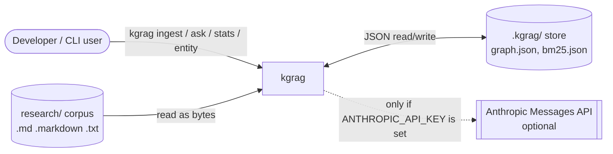
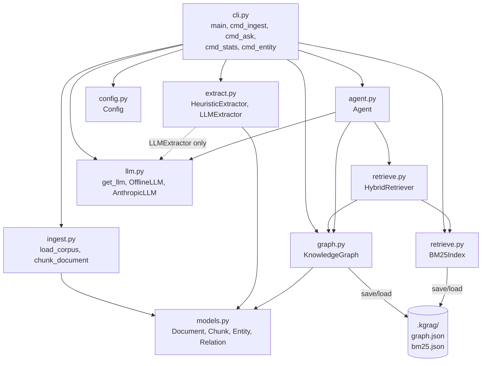

# Architecture

`kgrag` is a stdlib-only knowledge graph plus agentic RAG over a local folder of Markdown/text files. There is no graph database and no server: everything lives in memory while running and persists as two JSON files under the store directory (`.kgrag/` by default).

See also: [HLD](HLD.md) (data flow and design decisions), [LLD](LLD.md) (classes, agent loop, ids, store layout), [USAGE](USAGE.md).

## System context

The network box is optional. Without a key the deterministic `OfflineLLM` is used and nothing leaves the machine.

## Components

| Component | Responsibility |
|---|---|
| CLI (`kgrag/cli.py`) | argparse front end; errors go to stderr with exit code 1, no stack trace. |
| Ingest (`kgrag/ingest.py`) | Recursive load of supported files, paragraph-packed chunks with exact character offsets. |
| Extract (`kgrag/extract.py`) | Entities and relations with chunk-level evidence. Heuristic by default; LLM extractor falls back to heuristic per chunk. |
| KnowledgeGraph (`kgrag/graph.py`) | In-memory graph: merge by normalized name/alias, neighbors, degree stats, JSON persistence. |
| BM25Index (`kgrag/retrieve.py`) | Lexical index over chunks, persisted to `bm25.json` together with the doc id to path map. |
| HybridRetriever (`kgrag/retrieve.py`) | Fuses BM25 ranking with graph-expansion ranking via reciprocal rank fusion. |
| Agent (`kgrag/agent.py`) | Tool loop (`search`, `lookup_entity`, `expand`, `finish`), citation verification, relevance gate, offline policy. |
| LLM client (`kgrag/llm.py`) | `get_llm` returns `AnthropicLLM` when `ANTHROPIC_API_KEY` is non-empty, else `OfflineLLM`. |
| Store (`.kgrag/`) | Rebuilt from scratch on every `ingest`; gitignored. |
