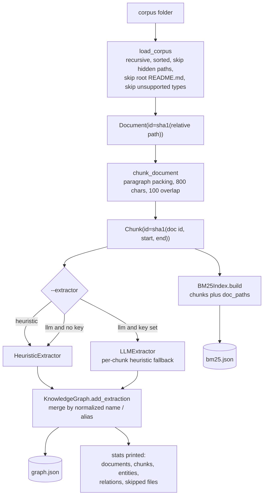
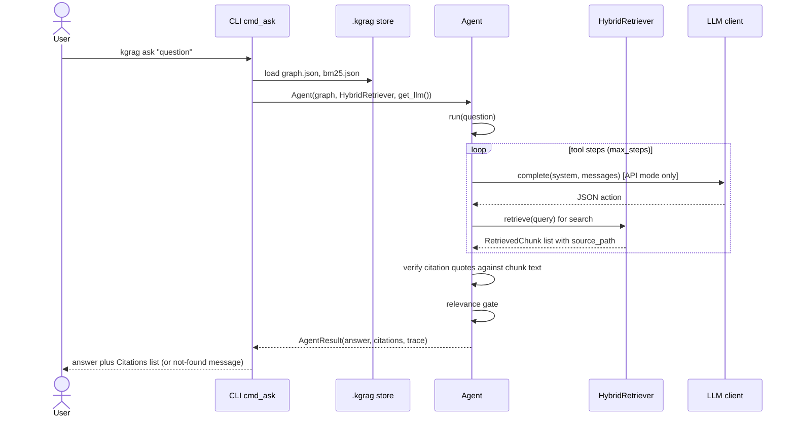
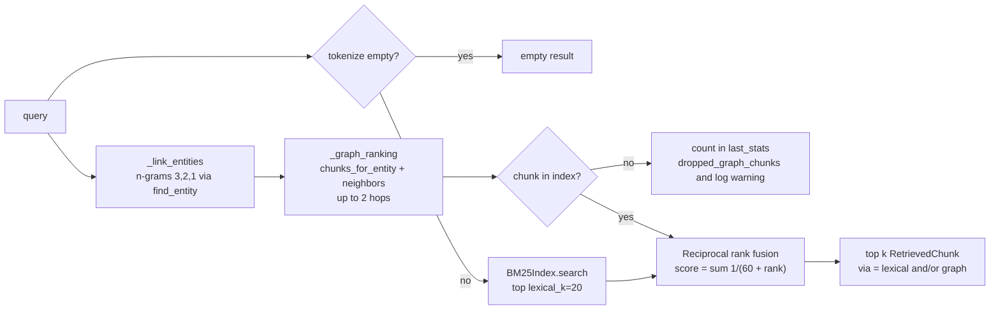

# High-level design

Companion docs: [ARCHITECTURE](ARCHITECTURE.md), [LLD](LLD.md), [USAGE](USAGE.md).

## Ingest data flow

`kgrag ingest` always rebuilds the store from scratch, so repeated runs give identical output.

## Ask data flow

## Retrieval

## Design decisions

| Decision | Rationale | Cost |
|---|---|---|
| **Stdlib only** (`dependencies = []`) | Regulated environment, no dependency approvals, easy to audit. | Hand-written BM25 and regex extraction; lower quality than embeddings or NER. |
| **Offline fallback** | `get_llm` returns `OfflineLLM` when the key is missing or blank. A deterministic policy (mentions, search, lookup, one-hop expand) drives the agent. Also used when LLM output is malformed after one retry; the fallback is recorded in the trace. Keeps tests and evals hermetic. | Offline answers are extractive sentences, not synthesized prose. |
| **RRF fusion** | Combines BM25 and graph rankings without tuning score scales. `RRF_K = 60`. | Ignores score magnitudes. |
| **Relevance gate** | The best evidence sentence must share at least two query terms, or half of them. Otherwise the answer is the not-found message with no citations. | Can refuse terse questions whose terms are rare in the corpus. |
| **Verbatim-citation check** | LLM citations are kept only if the quote (whitespace-squashed) is a substring of the cited chunk text. If none survive, the offline policy answers instead. | Paraphrased quotes are dropped. |
| **No graph database** | The corpus is small; an in-memory `KnowledgeGraph` persisted as JSON is enough and needs no service. | No query language and no scale beyond memory. |
| **Deterministic ids** | SHA-1 of relative path and offsets make ingest idempotent. | Moving a file changes its ids. |
| **Real source paths** | Retriever raises `MissingDocPathsError` if the index has no path map, and marks unknown docs `<unknown:DOC_ID>`, so a raw doc id never appears as a citation path. | Indexes must be built with `doc_paths`. |
