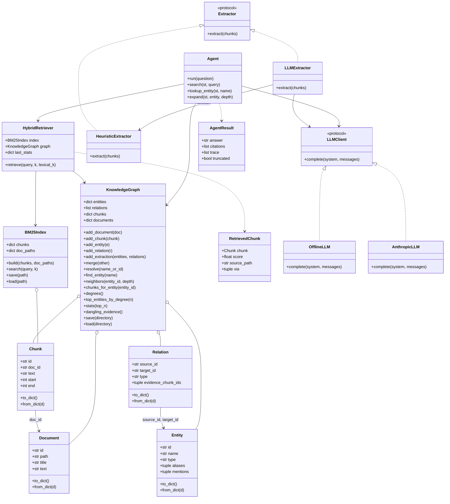
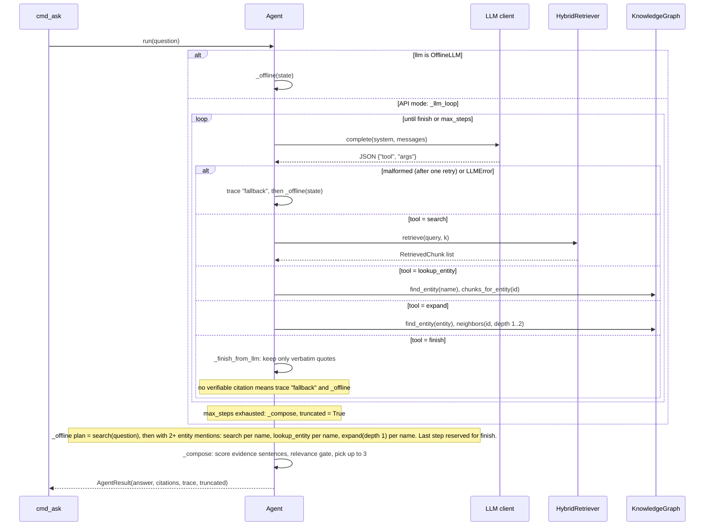

# Low-level design

Companion docs: [ARCHITECTURE](ARCHITECTURE.md), [HLD](HLD.md), [USAGE](USAGE.md).

## Models and main classes



All four models are frozen dataclasses with tuple list-fields, so they are hashable and round-trip through `to_dict`/`from_dict`.

## Agent loop

With a real LLM (`AnthropicLLM`), the model picks tools. With `OfflineLLM`, `Agent.run` goes straight to the deterministic policy `_offline`. `_next_action` allows one retry on malformed output; after that, or on an `LLMError`, the agent records a `fallback` step in the trace and runs `_offline`.



`_compose` returns `NOT_FOUND` with empty citations when no sentence passes the relevance gate. Offline answers cite each picked sentence as `[n]` with `{doc_path, chunk_id, quote}`.

## Id hashing scheme

Defined in `kgrag/ingest.py` (`_stable_id`) and `kgrag/graph.py` (`entity_id`).

| Object | Id |
|---|---|
| Document | first 16 hex chars of SHA-1 over the POSIX path relative to the corpus root |
| Chunk | first 16 hex chars of SHA-1 over `doc.id`, `start`, `end` (parts joined with `\x1f`) |
| Entity | `ent-` plus the normalized name (`norm_key`: lowercase, whitespace/hyphen/underscore folded to one space, last token singularized) with spaces as `-` |

Files are read as bytes and decoded as UTF-8, so `Chunk.text == Document.text[start:end]` holds exactly. The same corpus therefore always yields the same ids and the same store.

## Store file layout

```
.kgrag/                  (default; set with --store; gitignored)
├── graph.json           KnowledgeGraph.to_dict()
│     schema_version     currently 1
│     documents[]        id, path, title, text
│     chunks[]           id, doc_id, text, start, end
│     entities[]         id, name, type, aliases[], mentions[] (chunk ids)
│     relations[]        source_id, target_id, type, evidence_chunk_ids[]
└── bm25.json            BM25Index.save()
      chunks, doc_paths (doc id -> relative path), k1, b
```

Entries are sorted by id when written, so output is stable between runs.
